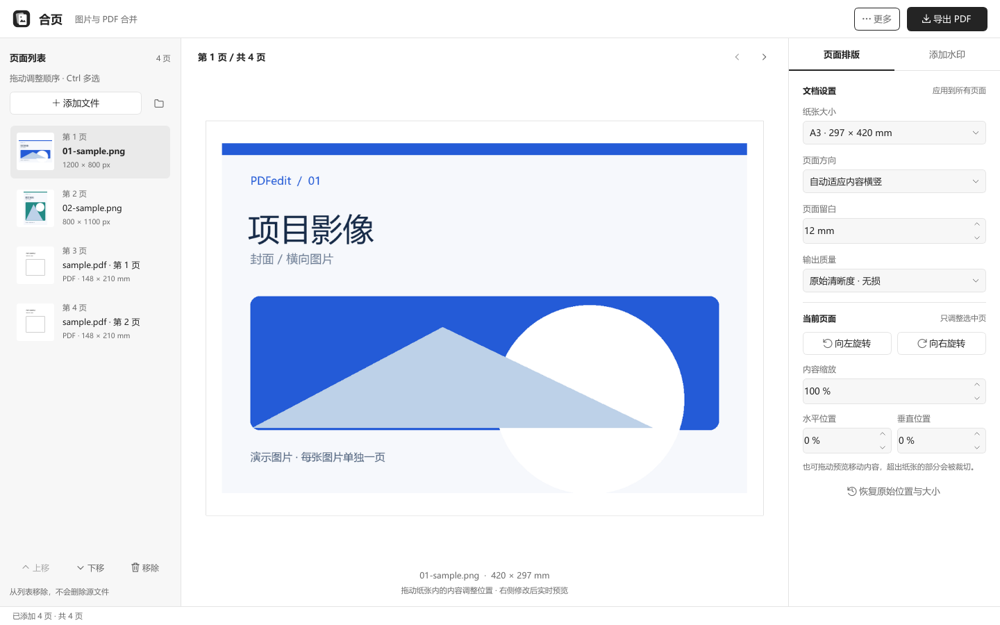
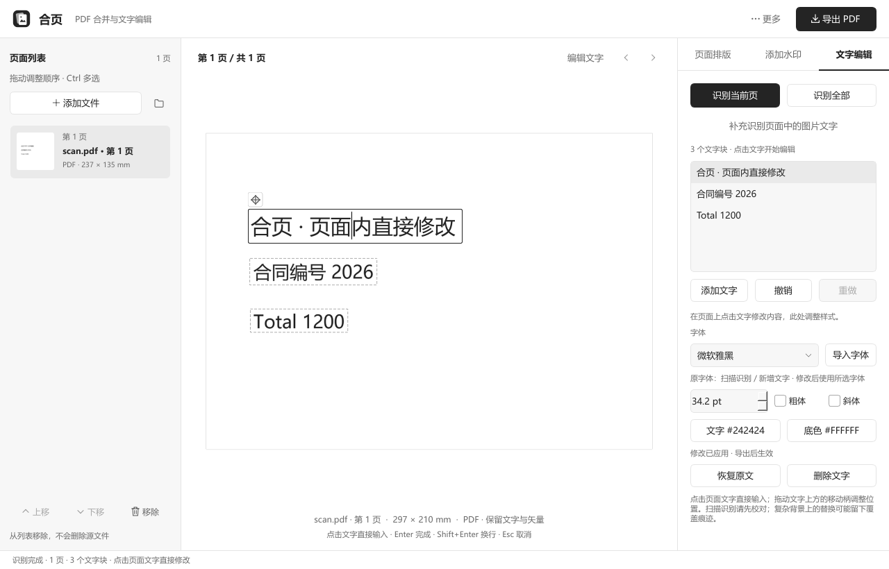
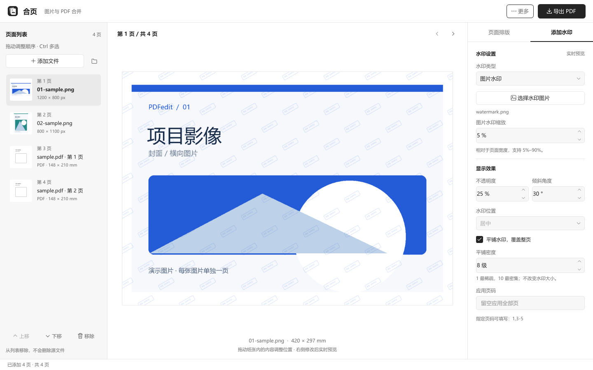

# 合页 · 把零散，合成完整

**整理 PDF，也能识别和修改其中的文字。** 一个本地运行的 Windows 桌面工具，支持图片 / PDF 混合、逐页预览、文字编辑、扫描件 OCR、页面排版和文字 / 图片水印。

[](https://github.com/liutaotao520/pdfredit/actions/workflows/ci.yml)
[](LICENSE)



## 能做什么

- **图片与 PDF 混合导入**：添加文件、拖入窗口或添加文件夹；每张图片一页，多页 PDF / TIFF 自动展开。
- **逐页调整**：拖动排序，旋转、缩放、调整位置，修改后实时预览。
- **识别并在页面上编辑**：单页、多页、合并后的 PDF 均可识别；点击页面文字直接输入，侧边栏调整字体、字号、颜色、粗体和斜体，支持移动、新增、删除、撤销、重做及恢复原文。
- **本地 OCR**：内置中文 / 英文识别模型，扫描 PDF 和图片可生成可搜索文字，再校对和编辑；不需要在线下载模型。
- **常用纸张**：A3、A4 等纸张，横向 / 纵向 / 自动方向，或跟随原始页面尺寸。
- **自定义水印**：文字或图片，透明度、角度、位置、指定页码和整页平铺；图片水印最小 5%，平铺密度 1–10 级。
- **本地处理**：不上传文档，不需要账号；合并过程不修改源文件。
- **继续编辑**：将识别结果、文字修改、排序与排版保存成 `.ipdf.json` 编辑方案，兼容旧版方案。
- **Windows 右键入口**：选择图片与 PDF 后，通过“合并为 PDF（合页）”打开。

普通 PDF 的原有文字和矢量内容直接参与合并，可搜索文字继续保留。点击“编辑文字”可提取原文，扫描件自动使用本地 OCR。界面采用黑白灰配色，退出、导出和进度弹窗保持一致。

### 1.4.2：在文档里，直接改字

打开“文字编辑”并识别当前页后，直接点击页面里的文字输入。`Enter` 完成、`Shift+Enter` 换行、`Esc` 取消当前输入；字体、字号与颜色在右侧调整，拖动文字上方的移动柄可以调整位置。单张 PDF、合并后的多页 PDF 和扫描件都可以进入这一流程，扫描识别结果请先校对。



## 开始使用

当前版本 **1.4.2**，运行平台为 Windows 10（2004 或更新）/ Windows 11，64 位。尚未在 GitHub 发布此版本的官方 EXE 下载；可以按下方步骤从源码运行，或自行构建。macOS / Linux 尚未支持。

准备 Python 3.12（64 位）与 Git，在你有写入权限的目录中打开 PowerShell：

```powershell
git clone https://github.com/liutaotao520/pdfredit.git
cd pdfredit
py -3.12 -m venv .venv
$env:PIP_CACHE_DIR = "$PWD\.task_tmp\pip-cache"
New-Item -ItemType Directory -Force .task_tmp\install-temp | Out-Null
$env:TEMP = "$PWD\.task_tmp\install-temp"
$env:TMP = $env:TEMP
.\.venv\Scripts\python.exe -s -m pip install --only-binary=:all: -r requirements.txt
.\.venv\Scripts\python.exe -B -s -X utf8 main.py
```

之后可双击 [启动合页.cmd](启动合页.cmd)。无需激活虚拟环境。软件可以放在任一本地盘的普通可写文件夹中；1.3.4 移除了旧版的 D 盘限制。请保留完整目录。

1. 点击“添加文件”，或者拖入图片、PDF。文件夹导入只扫描当前层。
2. 左侧拖动排序，Ctrl 多选；选中页面后在右侧调整排版。
3. 需要改字时，点击“文字编辑 → 识别当前页 / 识别全部”，然后直接点击页面文字输入。Enter 或点击空白处完成，Shift+Enter 换行，Esc 取消本次输入；也可添加新文字。
4. 在“添加水印”中设置文字或图片水印；需要更多水印时提高平铺密度。
5. 点击“导出 PDF”，核对页数、文件名和保存目录后导出。



更多操作与格式说明见 [使用指南](docs/USER_GUIDE.md)。构建 EXE 和安装包见 [开发与构建](docs/DEVELOPMENT.md)。

## 格式与边界

| 输入 | 处理方式 |
| --- | --- |
| JPG / JPEG、PNG、WebP、BMP、HEIC / HEIF、AVIF | 每张图片一页 |
| TIFF、PDF | 多页文件按页展开，可与图片混排 |
| GIF、APNG 等动画 / 多帧图片 | 首帧 / 主图 |
| SVG | 栅格化后导出，最长边至多 4096 像素 |
| ICO、ICNS、TGA、PCX、PPM / PGM / PBM、JPEG 2000、DDS、QOI | 取决于解码器与文件编码 |
| PSD | 读取可兼容的合成预览，不编辑图层 |

不支持任意格式的通用转换，也不包含相机 RAW、AI / EPS。单张图片最多 8000 万像素，单个 PDF / TIFF 最多 2000 页。整批导出会使用内存，很多高清页面建议分批处理。

输出是包含独立页面的静态 PDF。可见表单与批注会固定为页面内容，交互表单、链接、书签、附件和数字签名效力不保留；需要打开密码的文件请先解密另存。水印是视觉标记，不是加密或权限控制。

文字编辑以文字块为单位，不提供 Word 式跨页重排。普通文字修改会移除对应原文再写入新字；修改嵌套 PDF 内容流或 PDF 中的 OCR 文字时，会把该页其余外观固定为最高 300 dpi（最长边 5000 像素），并补回已识别的可搜索文字。扫描件需人工校对，覆盖旧字时可调整底色；复杂纹理、弯曲 / 手写 / 低清文字可能效果有限。覆盖编辑不是安全涂黑，不能用于彻底清除保密内容。详见[文字编辑说明](docs/USER_GUIDE.md#文字编辑与本地-ocr)。

## 开发

```powershell
.\.venv\Scripts\python.exe -s -m pip install --only-binary=:all: -r requirements-lock.txt
.\.venv\Scripts\python.exe -B -s tools/run_tests.py
```

测试包含实际 Qt 弹窗、异步识别 / 导入 / 导出、文字替换与字体嵌入、本地 OCR、方案恢复、文件保护、PDF 文字与矢量保留、纸张、水印和多种图片解码。GitHub Actions 在 Windows 上执行相同的回归测试。[构建步骤、目录结构和发布说明](docs/DEVELOPMENT.md)提供完整命令。

欢迎通过 [Issues](https://github.com/liutaotao520/pdfredit/issues) 提交问题和建议，或阅读 [贡献指南](CONTRIBUTING.md) 后提交 Pull Request。历史变更见 [CHANGELOG](CHANGELOG.md)。

## 许可与依赖

本项目自有源码、图标和示例采用 [MIT License](LICENSE)，允许使用、修改、分发和商用，需保留许可与版权声明。

第三方库保留各自许可证。特别是 Qt / PySide6、PDFium，以及 HEIF 预编译库带有不同的许可条件，**本项目的 MIT 许可不代表整个打包 EXE 都是 MIT**。本仓库不分发第三方运行时二进制；重新分发安装包前，请阅读 [第三方依赖说明](THIRD_PARTY_NOTICES.md)。

感谢 [Qt for Python](https://doc.qt.io/qtforpython-6/)、[Pillow](https://pillow.readthedocs.io/)、[pillow-heif](https://github.com/bigcat88/pillow_heif)、[ReportLab](https://www.reportlab.com/)、[pypdf](https://pypdf.readthedocs.io/)、[pypdfium2](https://github.com/pypdfium2-team/pypdfium2)、[RapidOCR](https://github.com/RapidAI/RapidOCR)、[ONNX Runtime](https://onnxruntime.ai/)。
